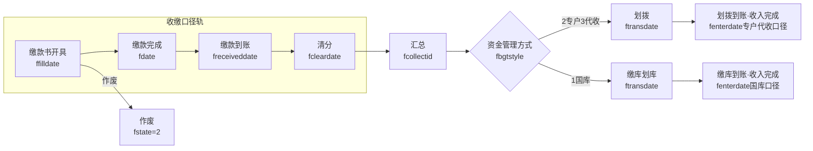
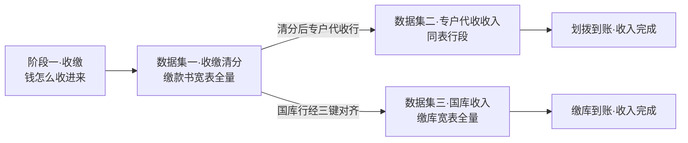

# 非税收缴与收入双轨业务介绍（基于 Kimball 架构）

> 本文是非税收缴与收入双轨的**业务介绍**：以资金链为主线讲清业务过程本身——钱怎么收进来、钱怎么分、怎么拨。Kimball 维度建模只作为数据组织的骨架，业务过程按它落成事实数据集与维度族；方法论对照见附录 A，正文不展开建模推导。

## 〇、导读

非税收缴是"一笔钱从缴款人流向最终归宿"的完整资金链。整条链分为两个业务阶段：

- **阶段一（收缴）**回答"钱怎么收进来"——缴款书开具、缴款完成、缴款金额到账、清分；
- **阶段二（收入）**回答"钱怎么分、怎么拨"——清分后按资金管理方式分流：专户/代收资金走划拨，国库资金走缴库，各自以到账为收入完成。

两个阶段对应两种统计口径（收缴口径、收入口径）；清分是两者的衔接点——清分完成即资金离开执收侧。资金链全景如下：

后文安排：第一章交代业务基础（管理架构、数据层级、单位主体、资金性质）；第二章按环节展开两个阶段的业务全景；第三章讲清双轨口径；第四章说明业务如何落成三个事实数据集；第五章给出七个维度视角；第六章把典型业务问题映射到统计口径；第七章是术语表。

## 一、业务基础：谁在收钱、钱怎么分类

### 1.1 管理架构

一个区划下设多个**主管部门**，一个主管部门下设多个**执收单位/收入单位**，一个执收单位可执收多个**收费项目**。主管部门 ID 随单位字段（fchgfindeptid）携带，可按"区划—主管部门—单位"逐层汇总。

### 1.2 数据层级

业务分类自上而下为：**资金性质 > 预算科目 > 收费项目**。每个收费项目有对应的预算科目、资金性质、收入类别；统计上三层可独立分项，也可逐层下钻。

### 1.3 四类单位主体

| 主体 | 业务职责 | 宽表字段组 | 回答的问题 |
|---|---|---|---|
| 开票单位 | 财政票据开具主体，负责票据申领、开具、保管与核销 | faccagencode / faccagenidcode / faccagenname | 这张票是谁开的 |
| 执收单位 | 财政收入（非税）征收责任主体，负责项目管理、款项收取、资金上缴 | fchgagencode / fchgagenidcode / fchgagenname | 钱从谁手上收进来 |
| 收入单位（清分后收款单位、记账单位） | 清分规则分出的收款方，资金实际归宿的记账主体 | frecagenidcode（清分后落值） | 谁实际得到这笔收入；"本单位收入"按它统计 |
| 预算单位 | 缴款书归属的预算单位 | fchgbgtagencode / fchgbgtagenname | 按预算口径看这笔钱 |

说明：

- 开票单位与执收单位业务上分设，编码可能一致但口径不同，不可混用。
- 执收单位"编码—识别码"为一对多：fchgagencode 对外展示，fchgagenidcode 内部唯一键（识别码→编码单射）；精确到户统计用识别码。
- 国库缴库侧另有**征收机关**（ftaxorgcode）与**财政主体**（ftaxpayercode / ftaxpayername，原税收口径列名"纳税人"，实为财政局）。

### 1.4 资金性质与资金管理方式

资金性质在链路上出现两次，是两个字段：

- **缴款书侧资金性质**（ffundsnaturecode / ffundsnaturename）：开票时落值，决定按哪套规则清分；
- **收入资金性质**（frecfundsnaturecode / frecfundsnaturename）：清分后落值，决定这笔钱最终归入哪类预算资金。两者取值可不同，不可混用。

清分后收入资金性质与**资金管理方式**（fbgtstyle）共同决定资金链的分支：

| 收入资金性质 | 资金管理方式 | 收入归宿 |
|---|---|---|
| 一般公共预算收入 / 政府性基金预算收入 / 国有资本经营预算收入 | 1 国库 | 缴库入人民银行国库 |
| 社会保险基金预算资金 | 2 专户 | 划拨入财政专户 |
| 财政专户管理资金（如教育收费：高中以上学费） | 2 专户 | 划拨入财政专户 |
| 代收资金 | 3 代收 | 划拨入代收账户 |

资金管理方式是整条链的**分叉字段**：'1' 走缴库，'2'/'3' 走划拨（另有 '4' 其他，链路同专户/代收）。第二章、第四章的分支都由它展开。

## 二、业务全景：一条资金链、两个阶段

### 2.1 阶段一（收缴）——钱怎么收进来

**环节一　缴款书开具。** 执收单位端选择收费项目、填写执收数量与金额、确认开票；系统生成缴款码（一笔缴款一个码）、票据号与校验码，给出票面收款账户与开户行，缴款书带有效期。此时缴款书状态为"正常未缴"（fstate='1'），落开具日期 ffilldate。业务对象：**缴款书（票）**。

**环节二　缴款完成。** 缴款人通过银行或缴费渠道缴款，银行把缴款信息回传财政端；财政端按缴款码回查缴款书，置为"已缴款确认"（fstate='3'），写缴款确认日期 fdate，并把票面与明细数据按缴款码落到财政端。业务对象：**缴款书、缴款明细**。

**环节三　缴款金额到账。** 日终缴款资金到账，财政端按银行回单逐条标注到账（fisreceived='1'），写缴款到账日期 freceiveddate。**到账即收缴完成**——口径意义上的"钱已收进来"。无新对象，状态推进。

**环节四　清分。** 财政端按资金性质等清分规则，把一笔缴款明细金额清分（分成）：一条缴款明细可拆为多条清分记录，每条带分入金额 fimamt 与分入方；清分结果的维度——收入区划、清分后收款单位（收入单位）、收入科目、收入资金性质——同步落值。完成标志 fisclear='1'，落清分日期 fcleardate。**清分完成＝阶段一的终点、阶段二的起点**：钱从这一步起离开执收侧口径，进入"钱怎么分、怎么拨"。

### 2.2 阶段二（收入）——钱怎么分、怎么拨

前提：已清分（fisclear='1'）的清分记录，按资金管理方式 fbgtstyle 分两条链。

**环节一　汇总。** 多笔清分记录按银行与日期归集，汇总成**汇总单**（汇总单号 fcollectid）。

**环节二A　划拨（专户/代收资金，fbgtstyle 2/3）。**

- *划拨*：多张汇总单按银行与日期合并生成**划拨单**（划拨单号 ftransno，#CZ 开头 23 位），组装付款账户与划拨收款账户（专户/代收收款方），发起划转（fistransfer），落划转日期 ftransdate；划拨状态 fstats 依次推进：1 划转已发 → 9 划转成功（7 划转失败为异常分支）。
- *划拨金额到账*：财政端接收银行划拨回执，按收入单位标注到账（fisenter='1'），落划拨到账日期 fenterdate。到账必有划转成功（fisenter='1' ⇒ fstats='9'）。**到账即收入完成（专户/代收）**。

**环节二B　缴库（国库资金，fbgtstyle 1）。**

- *缴库*：汇总后缴库，生成**缴库凭证**（缴库凭证号 ftransno，02 开头 18 位），划库（落划库日期 ftransdate）；缴库状态 fstatus 推进：'2' 未完成 → '9' 划库成功。
- *缴库金额到账*：入库到账（fstatus='9' 时到账），落缴库到账日期 fenterdate。**到账即收入完成（国库）**。
- 缴库环节的记账粒度是**缴库拆分行**：一张缴库凭证按分入区划、缴库科目拆为多行，每行是一笔独立金额。

**收入完成的分叉汇总：**

| 去向 | 收入完成标志 | 收入时间锚 |
|---|---|---|
| 专户/代收 | 划拨到账 fisenter='1' | fenterdate（划拨到账日期·专户代收口径） |
| 国库 | 缴库到账 fstatus='9' | fenterdate（缴库到账日期·国库口径） |

### 2.3 关键链路与业务对象总表

| 环节 | 业务对象 | 备注 |
|---|---|---|
| 缴款书开具 | 缴款书（票） | 执收单位端发起；生成缴款码、票据号、票面收款账户 |
| 缴款完成 | 缴款书、缴款明细 | 银行回传，财政端按缴款码落库 |
| 缴款金额到账 | —（状态推进，无新对象） | 日终批处理；到账即收缴完成 |
| 清分 | 清分记录（清分行） | 按资金性质等规则清分（分成），一条明细可拆多行；清分完成＝两阶段衔接点 |
| 汇总 | 汇总单 | 多笔清分记录按银行与日期汇总成单 |
| 划拨 | 划拨单 | 只发生在专户与代收资金上；国库资金走缴库、不进入划拨 |
| 划拨金额到账 | —（状态推进，无新对象） | 专户/代收收入完成 |
| 缴库 | 缴库凭证（拆分行） | 国库资金专属；一行＝缴库凭证×分入区划×缴库科目 |
| 缴库金额到账 | —（状态推进，无新对象） | 国库收入完成 |

### 2.4 作废旁路

已开具未缴款的缴款书可以作废（fstate='2'），作废后不进入缴款、到账、清分链路——这是整条资金链上唯一的分支。作废缴款书是收缴侧存量状态之一，其票面金额不参与任何收入统计。

### 2.5 两个阶段在数据上的形态

- **两个阶段不是两张表，而是同一张缴款书宽表（fne_paybook_full_high）上两组字段的子集**。收缴字段组（票面、明细、到账、清分状态）回答"收了多少、清分给了谁"；收入字段组（清分后落值的收入区划、收入科目、收入资金性质，以及划拨与到账字段）回答"钱分到了哪、到账没有"。
- 宽表**一行＝一条清分记录**（缴款书明细 × 分入方及分入金额）。因此收缴侧的票面金额、明细金额在行上随清分记录重复出现，**收缴统计必须按单据去重**；收入侧金额 fimamt 天然是行级原子金额，**直接求和**。
- 国库资金的收入段独立在**缴库宽表**（fne_treasury_transfer_new）：缴款书宽表只保留国库行的清分结果与缴库凭证号（ftreasuryno），缴库侧事实（收款国库、划库/入库日期、缴库状态、预算级次、征收机关）全部在缴库宽表，两表按三键对齐、不联表不回填（见第四章）。

## 三、双轨口径：同一笔钱的两种算法

### 3.1 收缴口径（显式口径）

- **定义**：缴款资金已到执收侧、尚未划拨或缴库的收入。
- **完成标志**：缴款金额到账（fisreceived='1'）。
- **时间锚**：freceiveddate（缴款到账日期·收缴口径）。
- **触发词**：仅当问数明确说"收缴收入""执收收入""征收收入"时按本口径理解。
- **金额**：执收到账金额（全口径）＝SUM(famt 明细金额) 按 (fpaycode, fid) 去重。

### 3.2 收入口径（默认口径，广义收入）

- **定义**：缴款资金完成划拨、到达资金归宿后的收入。
- **两个分支**：专户代收收入（锚 fenterdate·专户代收口径）＋国库收入（锚 fenterdate·国库口径）；广义收入＝两者之和。
- **判别标准**：以**资金是否离开执收侧**为界——已划拨/已缴库且到账＝收入（fenterdate）；仍在执收侧、以执收到账日期计＝收缴收入（freceiveddate）。
- **默认规则**：问数出现"收入"而未加限定词时，一律按本口径理解。
- **补充**："记账"全局按"到账即记账"理解：记账时间＝对应口径的到账时间（收缴口径 freceiveddate、专户代收/国库口径 fenterdate）；fcleardate 清分日期是"可入库口径"的入库日期，不承接"记账"问法。

### 3.3 全口径收入恒等式

> **全口径收入（专户＋代收＋国库，缴款覆盖月份）＝ SUM(专户/代收·fimamt) ＋ SUM(收缴清分·国库行·fimamt)**

- 国库侧自有金额 famt（缴库拆分行粒度）只用于国库单集统计与组级对账，**不与 fimamt 混加**。
- 国库段的时间轴取缴库侧的划库日期 ftransdate 与入库到账日期 fenterdate。

### 3.4 近义词分界

同一业务时点在不同口径下叫法不同，分界如下：

| 问法 | 归属口径 | 时间锚 |
|---|---|---|
| 收缴收入 / 执收收入 / 征收收入 | 收缴口径 | freceiveddate |
| 到账时间（收缴口径）/ 记账时间（收缴口径） | 收缴口径 | freceiveddate |
| 收入（未加限定词） | 收入口径 | fenterdate（按去向分段） |
| 专户收入 / 代收收入 / 专户资金收入 / 代收资金收入 | 收入口径·专户代收 | fenterdate |
| 国库收入 / 国库资金收入 | 收入口径·国库 | fenterdate |
| 到账时间（专户代收口径）/ 记账时间（专户代收口径） | 收入口径·专户代收 | fenterdate |
| 到账时间（国库口径）/ 记账时间（国库口径）/ 入库时间 | 收入口径·国库 | fenterdate |
| 缴款时间 / 缴款日期 | 业务事件 | fdate（缴库宽表 fpaydate 同义同值） |
| 清分时间 | 业务事件 | fcleardate（不承接"记账/到账/入账"问法） |
| 划拨时间 / 划转时间 | 业务事件 | ftransdate（专户代收侧） |
| 划库时间 | 业务事件 | ftransdate（国库侧） |
| 开票日期 / 开具时间 | 业务事件 | ffilldate |

## 四、数据的业务承接

### 4.1 三段业务 → 三个事实数据集

| 事实数据集 | 承接的业务段 | 数据来源 | 回答的问题 | 金额度量 | 主要时间锚 |
|---|---|---|---|---|---|
| 收缴清分 | 阶段一全程＋清分结果（国库/专户/代收全量） | 缴款书宽表全量（fbgtstyle 1/2/3 全取） | 收了多少、清分给了谁 | fimamt 清分明细金额（行级直加）；票面/明细金额按单据去重 | 缴款确认 fdate；缴款到账 freceiveddate |
| 专户/代收资金收入 | 阶段二·划拨分支 | 同一缴款书宽表的行段：fbgtstyle IN ('2','3') 且已清分（fisclear='1'） | 专户/代收资金划到哪、到账没有 | fimamt（本集唯一收入度量） | 划拨到账 fenterdate |
| 国库收入 | 阶段二·缴库分支 | 缴库宽表全量 | 国库资金缴到哪个国库、何时划库/入库、缴库状态如何 | famt 缴库拆分行金额（行级直加） | 缴库到账 fenterdate |

### 4.2 一行是什么：行粒度与五类单据

- **收缴清分 / 专户代收收入**：一行＝一条清分记录（缴款书明细 × 分入方及分入金额），行键 (fpaycode, fid, fcollectid)。
- **国库收入**：一行＝一条缴库拆分行（缴库凭证 × 分入区划 × 缴库科目的一笔独立金额），行键 (ftransno, forder)。

链上共五类单据对象，单据号即各环节的"身份证"：

| 单据 | 单据号字段 | 说明 |
|---|---|---|
| 缴款书 | fpaycode | 一笔缴款一个码；与 fpid 严格 1:1 但取值不同 |
| 缴款明细 | (fpaycode, fid) | 明细主键须两字段联合定位 |
| 汇总单 | fcollectid | 多笔清分记录按银行与日期汇总成单 |
| 划拨单 | ftransno（#CZ…23 位） | 专户/代收资金划出方向单据号 |
| 缴库凭证 | ftransno（02…18 位）＋行序号 forder | 国库资金缴库单据，按拆分行记账 |

注意：**ftransno 同名不同义**——收缴侧是划拨单号、缴库侧是缴库凭证号，格式即区分、值域零交集，不可混用。

**三个数据集之间的对齐（只声明关系，不做联表、不回填）：**

- **专户/代收收入 ⊂ 收缴清分**：行级子集。行键统一 (fpaycode, fid, fcollectid)，每一行即收缴清分的同一物理行，跨集对齐＝行键相等，无需 JOIN。
- **国库收入 ⇄ 收缴清分**：三键对齐 (ftreasuryno, frecrgncode, fsubcode) ＝ (ftransno, frecrgncode, fsubcode)，many_to_many。基数分两级：**组级一对一**（一个收缴清分三键组对应一个国库收入三键组）、**行级多对一**（组内 N 条清分记录对 1 条缴库拆分行）。
  - 收缴侧维度（项目、单位、资金性质、收入类别）只在收缴清分侧；缴库侧事实（收款国库、划库/入库日期、缴库状态、预算级次、征收机关）只在国库收入侧。
  - 对齐组内可含多个收费项目，缴库行金额 famt 不按项目拆分；项目粒度金额以收缴清分侧 SUM(fimamt) 为准。
- **专户/代收收入与国库收入之间无对齐关系**（专户/代收不经缴库，缴库凭证号无值）。

### 4.3 钱的守恒与对账

| 守恒式 | 含义 |
|---|---|
| 同一张缴款书 Σ明细金额＝票面金额 | 票面金额随清分记录行重复携带，求和须按缴款书（fpaycode）去重 |
| 同一缴款明细 Σ清分金额＝明细金额 | 清分是"分成"，拆分前后总额不变（Σfimamt 按明细＝famt） |
| 同一三键组 Σ清分金额（收缴侧）＝缴库拆分行金额（国库侧） | fimamt 与 famt 是两种粒度两种度量，不得混加；跨粒度核对只能按组级对账（Σfimamt(组)＝famt） |
| 汇总单/划拨单金额由行级 fimamt 按单据号归集 | 单据金额是归集结果，不是新的原子度量 |
| 全口径收入＝SUM(专户/代收·fimamt)＋SUM(收缴清分·国库行·fimamt) | 收入口径总量公式（见 3.3） |

## 五、维度视角：从哪些角度统计这笔钱

业务问题固定落在七个维度族上：限定条件在维度，统计结果在金额。

### 5.1 单位族

四类主体各有用途（见 1.3）：问"谁开的票"用**开票单位**；问"钱从谁手上收进来"用**执收单位**；问"谁实际得到收入"（含"本单位收入"）用**收入单位**（清分后收款单位）；按预算口径看用**预算单位**；按管理条线汇总用**主管部门**。国库缴库侧另有**征收机关**与**财政主体**（财政局）。

### 5.2 区划族

**执收区划**（钱从哪个区划收进来，fchgrgn*）与**收入区划**（清分后钱分到哪个区划，frecrgn*）是两个区划，可能不同、不可等同。跨区划问题（他区分入本区划、本区分到他区划）必须双区划联合过滤。缴库宽表只有分入区划与执收区划编码，执收区划名称经三键对齐回收缴清分侧取。

### 5.3 项目与科目族

**收费项目**（fitemcode/fitemname）：编码与名称非严格 1:1，分项统计以编码为准。**收入科目**（fsubcode/fsubname，即预算科目）：清分后落值为收入科目。缴库侧是**缴库科目**；缴库宽表无项目字段，项目维度经三键对齐回收缴清分侧取。

### 5.4 类型族

业务类型（1 直缴/2 汇缴）、缴款渠道、执收缴款渠道（三集同名同义）、资金性质（缴款书侧与清分后收入侧两个字段，见 1.4）、**资金管理方式**（国库/专户/代收，数据分叉字段）、**收入类别**（政府性基金收入、专项收入、行政事业性收费收入、罚没收入、国有资本经营收入、国有资源(资产)有偿使用收入、捐赠收入、政府住房基金收入、其他收入）、计量单位（非执收数量），以及国库侧的缴库模式、缴库类型（0 实时/1 批量/2 人工）、预算级次（1 中央/2 省/3 市/4 县/5 乡）。

### 5.5 账户与银行族

链上有三套收款账户，业务含义不同：

| 账户组 | 出现环节 | 收款方 |
|---|---|---|
| 缴款书票面收款账户（frecacct 组） | 收缴 | 待解缴账户/商业银行 |
| 划拨收款账户（ftransrecacct 组，6 字段成组） | 划拨 | 专户/代收收款方 |
| 缴库收款账户（frecacct 组·缴库侧，10 字段成组）＋缴库付款方账户（fpayacct 组，9 字段成组） | 缴库 | 人民银行国库 / 划库付款方 |

同名异义不跨集直通：frecacct 在收缴侧是票面收款账号、在缴库侧是缴库收款账号，码表也不同。缴款人缴款银行（fpaybank*，原代理银行）在收缴侧。

### 5.6 日期族

一条资金链的完整时间轴：

| 环节 | 时间字段 | 数据落点 |
|---|---|---|
| 缴款书开具 | ffilldate 缴款书开具日期 | 收缴清分 |
| 缴款完成 | fdate 缴款确认日期 | 收缴清分/专户代收（缴库宽表 fpaydate 同义同值） |
| 缴款金额到账 | freceiveddate 缴款到账日期（收缴口径） | 收缴清分/专户代收 |
| 清分 | fcleardate 清分日期（可入库口径） | 收缴清分/专户代收 |
| 划拨 | ftransdate 划转日期 | 专户代收 |
| 划拨到账 | fenterdate 划拨到账日期（专户代收口径） | 专户代收 |
| 缴库（划库） | ftransdate 划库日期 | 国库收入 |
| 缴库到账 | fenterdate 缴库到账日期（国库口径） | 国库收入 |

要点：

- 同一个日期维度以各环节角色出现：同一"日期"按开具、缴款、到账、清分、划拨、缴库等角色分别充当统计锚。
- **feffdate 缴款书有效期**是资格时间不是发生时间，不得用于时间统计。
- 缴库宽表的 fdate（单据生成日期）不进语义层；缴款时间一律用 fpaydate。
- "记账"在非税语境＝**到账即记账**：记账时间＝对应口径的到账时间。

### 5.7 状态族

| 字段 | 含义 | 取值与语义 |
|---|---|---|
| fstate 缴款书状态 | 票据生命周期 | 1 正常未缴 / 2 已作废 / 3 已缴款确认 |
| fisreceived 资金是否到账 | 银行口径 | '1' 到账 |
| fisclear 是否清分 | 清分进度 | 0 未清分 / 2 清分中 / 1 已清分 |
| fistransfer 是否划转 | 划拨发起判据 | 空串＝未划转（无 '0' 取值） |
| fstats 划拨状态 | 划拨推进 | 1 划转已发 / 7 划转失败 / 9 划转成功 |
| fisenter 划拨到账 | 专户/代收到账 | '1' 到账（必有 fstats='9'） |
| fstatus 缴库状态 | 缴库推进 | '9' 划库成功 / '2' 未完成 |
| fenterstatus 到账状态 | 与 fstatus 一一对应 | '9'↔'1'、'2'↔'0'；互为镜像，只取其一 |
| fincomestatus 收入状态 | 国库收入落账 | 0 未写收入 / 1 已写国库收入 |

状态字段回答"存量类"问题：查询时点处于某状态的业务对象还有多少、金额多少（见 6.3）。

## 六、典型业务问题与统计口径

### 6.1 收缴类

| 业务问法 | 统计口径 |
|---|---|
| 与去年对比整体征收（收缴）进度，按月同比 | 收缴口径·缴款书票面金额按缴款确认日期（fdate）同比；可按执收区划/主管部门/执收单位/资金性质/预算科目/收费项目分项 |
| 本年共完成收费多少笔 | 收缴口径·按缴款书去重计数，缴款确认日期在本年；可按业务类型分项 |
| 本年应缴未缴（未缴款销号） | 状态存量·fstate='1' 的缴款书张数与票面金额，按开具日期（ffilldate）圈定；缴款书未过期（有效期＞当前日期）且未作废 |
| 已缴未到账 / 已到账未清分 / 清分中 | 状态存量·按对应状态字段过滤（见 6.3） |

### 6.2 收入类

| 业务问法 | 统计口径 |
|---|---|
| 各单位/各科目/各项目/各资金性质/各收入类别的收入 | 收入口径·专户代收收入＋国库收入合成，按对应维度分项，以到账日期（fenterdate）圈定 |
| 分入本级国库收入 / 分入本级专户收入 | 收入口径·执收单位＋收入区划＝本级，按资金性质分项（国库：一般公共预算/政府性基金/国有资本经营；专户：财政专户管理资金/社会保险基金预算资金） |
| 其他区划分入本区划的收入 | 收入口径·收入区划≠本区划 且 执收区划＝本区划，按执收区划分项 |
| 本区划分到其他区划的收入 | 收入口径·执收区划＝本区划 且 收入区划≠本区划，按收入区分项 |
| 本区划已完成记账的收入 | 收入口径·到账即记账，按对应口径到账日期（fenterdate）圈定，可按执收单位分项 |
| 指定缴款码是否形成收入 | 该缴款码对应数据行是否进入专户/代收/国库的到账阶段——已到账即已形成收入，时间锚为对应数据行的 fenterdate |

### 6.3 状态存量类

| 业务问法 | 数据集 | 状态判据 |
|---|---|---|
| 专户待划转金额 | 专户/代收收入 | 未发起划转（fistransfer 空串） |
| 专户划转在途金额 | 专户/代收收入 | 划转已发未成功（fstats='1'） |
| 专户划转失败金额 | 专户/代收收入 | 划转失败（fstats='7'） |
| 专户成功未到账金额 | 专户/代收收入 | 划转成功但到账未确认（fstats='9' 且 fisenter='0'，对账差） |
| 国库缴库未完成金额 | 国库收入 | 缴库状态≠划库成功（fstatus≠'9'） |
| 缴款书已缴未到账金额 | 收缴清分 | 已缴款确认且资金未到账（fstate='3' 且 fisreceived≠'1'） |
| 缴款书已到账未清分金额 | 收缴清分 | 已到账且未清分（fisreceived='1' 且 fisclear≠'1'，含清分中） |
| 缴款书清分中金额 | 收缴清分 | 清分中（fisclear='2'，上一行的子集） |
| 缴款书作废金额 | 收缴清分 | 已作废（fstate='2'） |

说明：状态存量类问题**不可回溯、没有同比**——行集只随查询时点变化，不随统计区间变化；金额按对应单据粒度去重。

## 七、术语表

| 术语 | 含义 |
|---|---|
| 非税收入 | 政府除税收以外取得的收入，按收费项目征收；本文覆盖其收缴与收入全过程 |
| 缴款书（票） | 执收单位开具的收款凭证，一笔缴款一个缴款码（fpaycode） |
| 缴款明细 | 缴款书下按收费项目拆分的明细行，两字段 (fpaycode, fid) 联合定位 |
| 清分 / 分成 | 按资金性质等规则把一笔缴款明细金额拆分到分入方与分入区划 |
| 清分记录（清分行） | 缴款书明细 × 分入方及分入金额，收入侧的行级粒度 |
| 汇总单 | 多笔清分记录按银行与日期归集的单据（fcollectid） |
| 划拨 | 专户/代收资金从执收侧账户划往专户/代收账户（ftransno，#CZ 23 位） |
| 缴库 / 划库 | 国库资金缴入人民银行国库的过程（ftransno，02 18 位） |
| 缴库拆分行 | 缴库凭证 × 分入区划 × 缴库科目的一笔独立金额 |
| 三键对齐 | (缴库凭证号, 收入区划, 收入科目) 两侧对齐；组级一对一、行级多对一 |
| 行级子集 | 专户/代收收入是收缴清分的同一物理行子集，行键相等即对齐 |
| 收缴口径 | 钱已到执收侧、未划拨/未缴库；时间锚 freceiveddate |
| 收入口径（默认） | 钱已划拨/缴库且到账；时间锚 fenterdate；"收入"未加限定词一律按此 |
| 广义收入 | 专户代收收入＋国库收入 |
| 全口径收入恒等式 | SUM(专户/代收·fimamt)＋SUM(收缴清分·国库行·fimamt) |
| 资金管理方式 | 国库/专户/代收（fbgtstyle），决定收入分支的分叉字段 |
| 到账即记账 | 非税语境的"记账时间"＝对应口径的到账时间 |
| 时期型口径 | 以"日期字段落在统计区间"圈行，可回溯、可同比 |
| 状态存量口径 | 以"状态标志取指定值"圈行，不可回溯、无同比 |
| 守恒式 | 链上金额的恒等关系组（见 4.3），用于跨环节对账 |

## 附录 A　Kimball 骨架对照

本文以 Kimball 维度建模为骨架组织数据（方法论细节不展开，只列落点）：

| Kimball 概念 | 在本文档中的落点 |
|---|---|
| 业务过程 | 收缴（开具→缴款→到账→清分）与收入（汇总→划拨/缴库→到账）两条业务过程，按过程组织数据、不按报表 |
| 粒度声明 | 三个数据集各自声明"一行是什么"：清分记录 / 清分记录（行段） / 缴库拆分行（4.2） |
| 事实表 | 三个事实数据集（4.1），度量与外键、单据号、时间戳齐备 |
| 累积快照形态 | 缴款书宽表一行随业务推进持续更新各里程碑日期与状态 |
| 退化维度 | 五类单据号：缴款码、明细键、汇总单号、划拨单号/缴库凭证号（4.2） |
| 一致性维度 | 七个维度族跨数据集同名同义（第五章）；三键对齐是跨表一致性的显式声明（4.2） |
| 混粒度反模式 | 票面金额随清分记录行重复——按单据去重；fimamt 与 famt 两种粒度不得混加（4.3） |
| 角色扮演日期 | 同一日期维度以开具/缴款/到账/清分/划拨/缴库等角色出现（5.6） |
| 度量可加性 | fimamt、famt 行级原子金额可直加；票面/明细金额须去重后使用（4.3） |
